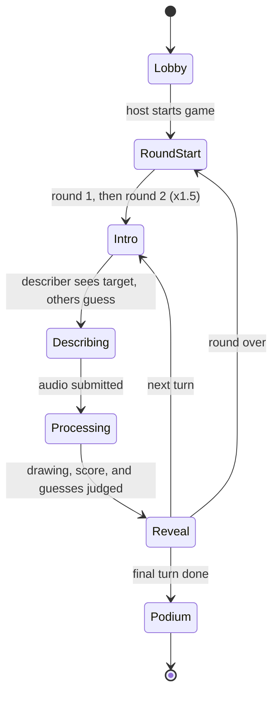
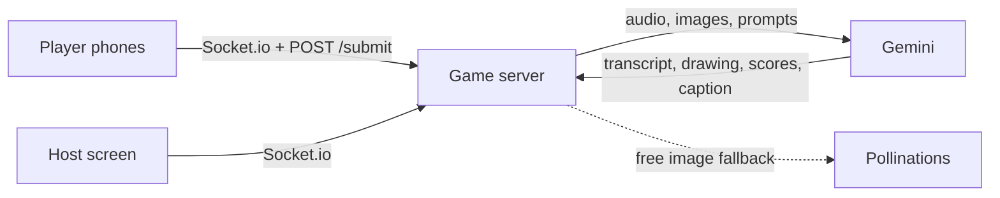

# Promptionary

Promptionary is a multiplayer party game built around the gap between what you say and what an AI understands. One player sees a secret image and describes it out loud without using any of its banned words. Gemini listens to the description, draws what it heard, and scores how close the drawing came to the original. Meanwhile, everyone else races to guess what the image is.

The game runs on a shared big screen (the host) with players joining from their phones by QR code. No accounts or app installs are required.

Built for an MLH hackathon, October 16–18, 2026, in the Entertainment & Creative Technology track.

## Contents

- [How the game works](#how-the-game-works)
- [Scoring](#scoring)
- [Architecture](#architecture)
- [AI pipeline](#ai-pipeline)
- [Getting started](#getting-started)
- [Testing](#testing)
- [Deployment](#deployment)
- [Project structure](#project-structure)
- [Team and contributions](#team-and-contributions)
- [Status and roadmap](#status-and-roadmap)

## How the game works

1. The host opens `/host` on a large screen. It shows a room code and a QR code.
2. Players (2 to 8) scan the code and join from their phones at `/play`.
3. On each turn, one player's phone shows a target image and its banned words.
4. That player has 20 seconds to describe the image by voice. Saying a banned word costs points.
5. Every other player types one guess at what the image shows. The guess clock starts when the describer says their first word, and faster correct guesses earn more.
6. The host screen plays the reveal: the original image and the AI's drawing side by side, with a match score, a short roast caption, what the AI got right and wrong, and everyone's points.
7. Everyone describes once per round. There are two rounds. Round 2 is worth 1.5x, and the turn order is reversed by score so the leader describes last.
8. The game ends with a podium and a Hall of Shame screen covering the night's worst misses and most-violated words. Players can start a new game from the same room.

If the image model refuses a description on safety grounds, the reveal shows a refusal card rather than an error. Sound effects (join, drumroll, score sting, banned-word buzzer) are synthesized in the browser, and the host can mute them.



## Scoring

Describer points per turn (before the round multiplier):

| Component | Points | Based on |
|---|---|---|
| Accuracy | up to 700 | How closely the AI's drawing matches the target |
| Clarity | up to 200 | The guessers' average accuracy |
| Speed | up to 100 | Time left on the clock, awarded only if the drawing scores at least 40% |
| Banned words | -100 each | Each banned word spoken |

Guesser points scale with both accuracy and speed. The maximum value of a single guess shrinks as the room grows, so guessing stays around 40% of a perfect game regardless of player count (capped at 400 per guess, 600 in round 2). Ties are broken by round 2 points, then by guessing points.

Every timing and point value lives in [`server/src/config.ts`](server/src/config.ts), and the scoring math is in [`server/src/scoring.ts`](server/src/scoring.ts). The full rules are documented in [`docs/data-contract.md`](docs/data-contract.md#2-game-flow).

## Architecture

| Layer | Technology |
|---|---|
| Frontend | Next.js 16, React 19, Tailwind CSS 4, Socket.io client, `qrcode.react` |
| Game server | Node.js, Express 5, Socket.io, TypeScript (run with `tsx`) |
| AI | Google Gemini via `@google/genai` (AI Studio keys or Vertex AI); Pollinations as a free image fallback |
| Image processing | `sharp` |
| Hosting | A single Vultr server with Caddy for HTTPS |
| CI | GitHub Actions |



The server owns all game state. Rooms, phases, timers, and scoring run in a server-side state machine ([`server/src/rooms/Room.ts`](server/src/rooms/Room.ts)), and the host and phones only render what the server broadcasts. Phase deadlines are sent as epoch timestamps so every screen counts down to the same moment. Describers who disconnect briefly (for example, a phone refresh) get a grace period to rejoin before their turn is skipped, and a host screen that drops can reconnect without closing the room.

The interface between the two halves is specified in [`docs/data-contract.md`](docs/data-contract.md): shared types, every socket event, the `/submit` endpoint and its status codes, and environment variables. Both sides are built against that document, and changes to it go in first.

## AI pipeline

For each turn:

1. **Transcribe.** Phones that support in-browser speech recognition (iPhone Safari, Android Chrome) send text directly. Others record 16 kHz mono WAV, which the server sends to Gemini for transcription.
2. **Check banned words** against the transcript.
3. **Draw.** The transcript is passed to the image model nearly verbatim so that the describer's mistakes carry through. Every prompt is prefixed with the art style used for the target cards, so drawings and targets look alike.
4. **Judge.** Once guessing closes, a single Gemini call compares the target and the drawing, writes the caption, and rates every guess from 0 to 100, returned as structured JSON. Combining these into one call conserves free-tier quota.

The pipeline is built to keep the game running when the AI does not cooperate:

- Each call has a 30-second timeout and one retry. After a rate-limit response the server stops calling that model until its quota resets.
- `GEMINI_API_KEY` accepts several comma-separated keys and rotates to the next when one runs out.
- If transcription fails, the describer can resend with 10 extra seconds. A second failure ends the turn with no penalty.
- If drawing or judging fails, the turn still completes, scored by word overlap with the target's prompt.
- If the Gemini image model is unavailable (it requires billing), Pollinations draws instead.
- Without any key, a deterministic fake AI ([`server/src/ai/fake.ts`](server/src/ai/fake.ts)) runs, which is also what the tests use.

Drawings are resized to 768px JPEGs, held in memory, and served from `GET /images/:id`.

The target bank contains 40 curated scenes (for example, a penguin waiter or a yeti in a sauna) defined in [`server/data/targets.json`](server/data/targets.json), each with an image prompt, banned words, and a difficulty. The images were generated by Gemini and are committed to the repository.

## Getting started

### Prerequisites

- Node.js 20 or later (CI uses 22)
- Optional: a [Gemini API key](https://aistudio.google.com/) or a Google Cloud project with Vertex AI enabled. Without one, the fake AI is used.
- Optional, for testing on phones: `cloudflared`

### Install and configure

```bash
git clone https://github.com/samanglo814/Reverse-Charades.git
cd Reverse-Charades

cd server && npm install && cp .env.example .env
cd ../web && npm install
```

Create `web/.env` with the server address:

```
NEXT_PUBLIC_SERVER_URL=http://localhost:4000
```

The main server settings in `server/.env` are listed below. [`server/.env.example`](server/.env.example) documents each one in detail.

| Variable | Purpose |
|---|---|
| `PORT` | Server port (default 4000) |
| `CLIENT_ORIGIN` | Web app URL(s) allowed by CORS, comma-separated |
| `PUBLIC_URL` | The server's address as browsers see it. Required once phones join, or target images will not load |
| `GEMINI_API_KEY` | One or more Gemini keys, comma-separated |
| `VERTEX_PROJECT`, `VERTEX_LOCATION` | Use Gemini through Vertex AI instead of AI Studio keys |
| `GEMINI_TEXT_MODEL`, `GEMINI_TRANSCRIBE_MODEL`, `GEMINI_IMAGE_MODEL` | Model overrides |
| `IMAGE_PROVIDER` | Set to `pollinations` to skip the paid Gemini image model |
| `POLLINATIONS_TOKEN` | Optional free token that raises Pollinations' rate limit |

### Run locally

```bash
# terminal 1
cd server && npm run dev

# terminal 2
cd web && npm run dev
```

Open `http://localhost:3000/host` on the main screen. Phones on the same network can join at `http://<your-lan-ip>:3000/play`, provided `PUBLIC_URL` and `NEXT_PUBLIC_SERVER_URL` point at the LAN address.

Phone browsers only allow microphone access over HTTPS. To test voice on phones, run `./dev-tunnel.sh` from the repository root instead. It starts both apps behind free Cloudflare tunnels and prints a public HTTPS host address, without modifying your `.env` files.

### Utility scripts (in `server/`)

| Command | Purpose |
|---|---|
| `npm run generate:images` | Generate images for targets that do not have one yet (`-- <id>` to redraw one, `-- --all` for all) |
| `npm run live:gemini` | Play a few rounds against the real Gemini API and save the drawings to `live-output/` |

## Testing

| Command (in `server/`) | Purpose |
|---|---|
| `npm test` | Unit and edge-case tests: scoring, banned words, targets, Hall of Shame, Gemini and Pollinations handling, join errors, rejoin, AI failure |
| `npm run bots` | Plays a full five-bot game against an in-process server and validates every payload against the data contract |
| `npm run check` | Typecheck, lint, tests, and the bot game |

GitHub Actions runs `npm run check` for the server and lint plus a production build for the web app on every pull request and on pushes to `main`.

## Deployment

The whole game (website, game server, and HTTPS) runs on one Vultr instance. On a fresh Ubuntu 24.04 server, as root:

```bash
curl -fsSL https://raw.githubusercontent.com/samanglo814/Reverse-Charades/main/deploy/vultr-setup.sh | bash
```

The script installs dependencies, builds both apps, configures Caddy for HTTPS, and registers `promptionary-server` and `promptionary-web` as systemd services. By default it serves the game at a free `sslip.io` address. To use a custom domain, point the domain and its `api.` subdomain at the server and run the script with `DOMAIN=yourdomain.com`. Running the same command again pulls the latest `main` and redeploys while keeping `.env`.

Full instructions, including AI key setup and troubleshooting, are in [`docs/deploy-vultr.md`](docs/deploy-vultr.md).

## Project structure

```
.
├── web/                    Next.js frontend
│   ├── app/
│   │   ├── page.tsx        landing page
│   │   ├── host/           big-screen views: lobby, reveal, scoreboard, podium, Hall of Shame, refusal card
│   │   └── play/           phone views: join, describe (mic), guess
│   ├── components/         shared UI
│   └── lib/                socket client, mic capture, submit helper, sounds, shared types
├── server/                 game server and AI pipeline
│   ├── src/
│   │   ├── app.ts          wires Express, Socket.io, rooms, and /submit
│   │   ├── config.ts       game rules
│   │   ├── scoring.ts      points math
│   │   ├── rooms/          room state machine, room codes, Hall of Shame
│   │   ├── http/           POST /submit
│   │   └── ai/             Gemini, Pollinations, fake AI, image store, art style
│   ├── data/               targets.json and target images
│   ├── scripts/            bot game, image generation, live Gemini test
│   └── test/
├── deploy/vultr-setup.sh   one-command production setup
├── dev-tunnel.sh           HTTPS tunnels for phone testing
└── docs/
    ├── data-contract.md    socket events, /submit, shared types
    ├── deploy-vultr.md     deployment guide
    └── figma-brief.txt     design brief for the scoring UI
```

See [`server/README.md`](server/README.md) for more detail on the server, AI behavior, and quota handling.

## Team and contributions

Contributions are summarized from the repository's pull request and commit history.

**[@samanglo814](https://github.com/samanglo814)** — Frontend, product design, AI integration, and infrastructure

- Wrote the original game concept and README.
- Built the web frontend from scratch: the Next.js scaffold and design tokens, host lobby with QR code, player join flow, microphone capture and submit helper, describe screen, reveal animation with roast captions, scoreboard and podium, Hall of Shame, refusal card, landing page, and synthesized sound effects.
- Authored the data contract that defines how the frontend and server communicate.
- Implemented the final UI from the Figma designs and one-tap guess locking.
- Hardened the AI pipeline for the free tier: multi-key rotation, quota-aware backoff, a separate transcription model, and optional Vertex AI support.
- Added the free Pollinations image provider and the HTTPS tunnel script for phone testing.
- Built the one-command Vultr deployment with HTTPS.
- Led the rename to Promptionary.

**Gabriel Goluch ([@GGoluch1](https://github.com/GGoluch1))** — Game server, game design, and AI pipeline

- Built the realtime game server: the Express and Socket.io scaffold, rooms and lobby, the server-owned round state machine, the `POST /submit` endpoint, and reconnect handling.
- Built the testing infrastructure: the automated five-bot game, unit tests, and the CI workflow.
- Wired the host and player screens to the live server.
- Built the core Gemini pipeline for transcription, drawing, scoring, and captions, along with the live Gemini smoke test.
- Created the target image bank and later doubled it to 40 targets with a shared art style for cards and drawings.
- Designed the two-round format with spectator guessing and the current points system, including the Figma design brief.
- Fixed the voice loop, Play Again, and repeated microphone prompts, and moved the guess clock to start at the describer's first word.

## Status and roadmap

In progress:

- Optional Auth0 sign-in for hosts (open pull request).
- Persisting round events to Tiger Data. The Hall of Shame is currently built from rounds held in memory; the planned schema is described in the data contract.

Planned:

- A shareable Storybook recap that turns each game's rounds into narrated chapters.
- A daily challenge with a shareable result card.
- A voiced narrator for the roast captions.
