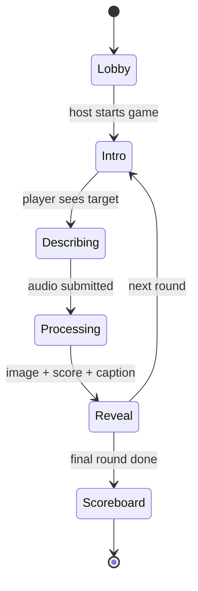
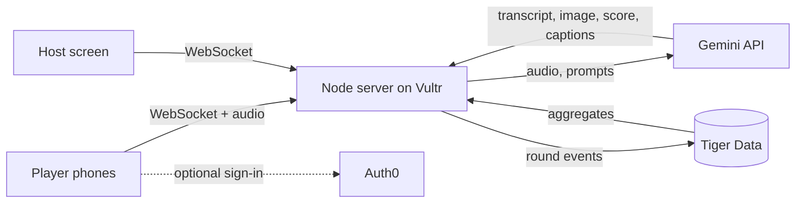

# 🎭 Lost in Description

**Charades, but you describe it and the AI draws what it *thought* you meant.**

A multiplayer party game where the fun is the gap between what you said and what the AI understood. One player sees a secret image and describes it out loud (without using the banned words). Gemini listens, draws what it understood, scores the match, and roasts the result. At the end of the night, the rounds become a shareable **Storybook**.

> Built for **[Hackathon Name]** (MLH), Oct 16 to 18, 2026 · Track: **Entertainment & Creative Technology (Swamp Studios)**

🌐 **Play:** [your-domain.example]  
🎬 **Demo video:** [link]  
📝 **Devpost:** [link]

---

## ✨ How It Works

1. **Host** opens the game on a big screen and shows a room code and QR code.
2. **Players** join on their phones, with no account needed.
3. On your turn, your phone shows a **secret image** and a list of **banned words**.
4. You have 20 seconds to **describe it by voice**. Say a banned word and you get buzzed.
5. **Gemini** transcribes your description, generates an image from it, and scores how close it got.
6. The **reveal** shows the original and the AI's version side by side, with a score and a roast caption.
7. After the final round: the **scoreboard**, the **Hall of Shame** (the night's worst misses), and a **Storybook** recap you can share.

### Game flow



---

## 🧱 Tech Stack

| Layer | Tech |
|---|---|
| Frontend | React + Tailwind (host view, player view, storybook) |
| Realtime backend | Node.js + Socket.io |
| AI | **Google Gemini API**: audio understanding, image generation, vision scoring, captions, storybook narration |
| Database | **Tiger Data** (Postgres + time-series) for round events and the Hall of Shame |
| Auth | **Auth0** (optional sign-in to save your gallery; guests join freely) |
| Hosting | **Vultr** |
| Domain | **GoDaddy Registry** |

### Architecture



### AI pipeline (per round)

1. **Audio in:** the player's recording goes to Gemini for transcript and delivery.
2. **Banned-word check:** string match on the transcript.
3. **Image generation:** the transcript is passed nearly verbatim so the mistakes stay authentic.
4. **Scoring:** a Gemini vision call compares the original and generated images and returns structured JSON (`score`, `got_right`, `got_wrong`).
5. **Caption:** a short, playful roast based on the transcript and score.
6. **Storybook:** at game end, all rounds are turned into titled chapters with narration.

If an image is blocked by safety filters, the game shows a **refusal card** instead of an error, because "the AI refused to draw that" is also funny.

---

## 🚀 Getting Started

### Prerequisites

- Node.js 20+
- A [Gemini API key](https://aistudio.google.com/)
- A Tiger Data (Postgres) connection string
- *(Optional)* an Auth0 tenant for sign-in

### Install

```bash
git clone [repo-url]
cd [repo-name]

# server
cd server && npm install

# web
cd ../web && npm install
```

### Environment variables

Copy the examples and fill them in:

```bash
cp server/.env.example server/.env
cp web/.env.example web/.env
```

**`server/.env`**

```
PORT=4000
CLIENT_ORIGIN=http://localhost:3000
PUBLIC_URL=
GEMINI_API_KEY=
GEMINI_TEXT_MODEL=
GEMINI_IMAGE_MODEL=
DATABASE_URL=
AUTH0_DOMAIN=
AUTH0_AUDIENCE=
DEMO_MODE=false
```

**`web/.env`**

```
NEXT_PUBLIC_SERVER_URL=http://localhost:4000
NEXT_PUBLIC_AUTH0_DOMAIN=
NEXT_PUBLIC_AUTH0_CLIENT_ID=
NEXT_PUBLIC_AUTH0_AUDIENCE=
```

> Model names are set by environment variable so they can be swapped without code changes. Check the Gemini docs for current model names.

### Database setup

Run once against your Tiger Data instance:

```sql
CREATE TABLE rounds (
  time          TIMESTAMPTZ NOT NULL DEFAULT now(),
  room_code     TEXT NOT NULL,
  round_index   INT NOT NULL,
  player_id     TEXT NOT NULL,
  target_id     TEXT NOT NULL,
  transcript    TEXT,
  banned_hits   INT DEFAULT 0,
  score         INT,
  latency_ms    INT,
  refused       BOOLEAN DEFAULT false
);

SELECT create_hypertable('rounds', 'time');
```

### Run locally

```bash
# terminal 1
cd server && npm run dev

# terminal 2
cd web && npm run dev
```

Open the host screen at `http://localhost:3000/host`, then join from a phone on the same network at `http://<your-local-ip>:3000/play`.

### Generate the image bank

```bash
cd server && npm run generate:images
```

This creates the target images used in rounds. Curate them in `server/data/targets.json` (banned words and difficulty per image).

### Demo mode

Set `DEMO_MODE=true` to replay cached results with no live API calls. This is useful for demos on shaky Wi-Fi or if API limits are hit.

---

## 🗂️ Project Structure

```
.
├── web/                  # frontend (host, player, storybook)
│   ├── app/
│   │   ├── host/         # big-screen view
│   │   ├── play/         # phone view
│   │   └── storybook/    # shareable recap
│   └── components/
├── server/               # realtime server + AI pipeline
│   ├── rooms/            # room state machine
│   ├── ai/               # Gemini calls (transcribe, generate, score, caption, story)
│   ├── db/               # Tiger Data schema + queries
│   ├── data/             # target images + banned words
│   └── scripts/          # image bank generation
└── docs/
    └── data-contract.md  # room events + API shapes
```

---

## 🏆 Sponsor Tracks

- **Entertainment & Creative Technology (Swamp Studios):** a game, interactive media, digital art, and storytelling in one.
- **Best Use of Gemini API:** audio in, images out, structured scoring, and long-context storytelling, all from one API.
- **Best Use of Tiger Data:** every round is logged as time-series data, powering the live Hall of Shame.
- **Best Use of Vultr:** the realtime server is deployed on Vultr.
- **Best Use of Auth0:** optional sign-in to save your gallery.
- **Best Domain Name from GoDaddy Registry:** [your-domain.example]
- **DEV Writing Challenge:** [link to post]

---

## 🧗 Challenges

- Keeping the reveal fast enough to feel like a game, using caching and a funny processing state
- Choosing target images that are easy to describe *wrongly*
- Handling image safety refusals gracefully
- Syncing a host screen and many phones in real time

## 🔮 What's Next

- Team mode (one describes, others guess what the AI will draw)
- Daily challenge with a shareable result card
- Voiced narrator for roast captions

---

## 👥 Team

- **[Name A]**: frontend, design, content ([GitHub](https://github.com/))
- **[Name B]**: backend, AI, infrastructure ([GitHub](https://github.com/))

## 📄 License

[MIT](LICENSE)
